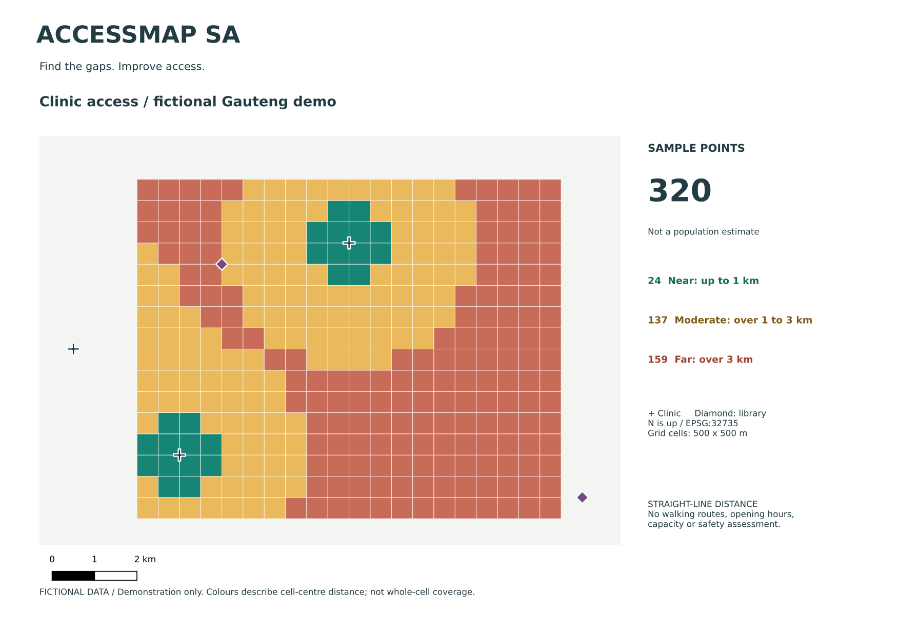

# AccessMap SA

**Find the gaps. Improve access.**

A small, offline-first QGIS project for exploring distance to essential community services, with a shared iOS/Android mobile concept. Built by Kaziwale Farai Masheke.

> **v0.1 is a fictional demonstration, not a directory of real services.** Every included facility, community point and grid cell is synthetic. The coordinates are placed in Gauteng to demonstrate an appropriate local projection. Do not use the demo for navigation, emergency decisions, service allocation or claims about any actual community.



## Start in two minutes

1. Download and extract the whole release folder, keeping its structure.
2. Open **`AccessMap-SA.qgz`** in QGIS. No plugin, network or account is needed to view it.
3. The clinic grid is visible first. Toggle it off and the library grid on to compare categories.
4. Open **Project → Layouts** and select either prepared print layout. Both use fictional data and a 500 m sample grid.
5. Inspect the facility or access-point tables. A coloured square describes its **centre point**, not the distance everywhere inside that square.

The project uses relative paths and a single GeoPackage. Keep the `data` folder beside the project. It has no automatic startup Python or remote basemap requests. The build was integration-tested in QGIS 3.34.4; use a supported QGIS LTR for daily work and verify on that version before a real pilot. QGIS 4 native compatibility has not been certified.

## Analyse your own area

1. Prepare a point layer of public, aggregated community sample locations. Avoid identifiable household/resident records.
2. Prepare a point layer of facilities with unique `id`, `name` and `category` fields. Keep nearby facilities **outside** the study boundary so the nearest service is not artificially excluded.
3. In the Processing Toolbox, use **Scripts → Add Script to Toolbox** and choose `processing/accessmap_sa.py`.
4. Run **AccessMap SA: distance to essential services**. Select the two layers and their fields. Enter `clinic`, `library`, or another category in your own data.
5. Select a **local projected CRS with metre units**. EPSG:32735 is the demo default for Gauteng; do not reuse it blindly for the rest of South Africa or another country. Input layers are reprojected automatically by the QGIS tool.
6. Set exploratory near/far thresholds. Save the output to a **new** GeoPackage; never overwrite source layers. To reuse the sample colours, load `data/clinic_points.qml` in Layer Properties → Symbology → Style → Load Style.
7. Validate records and interpretation with the community before publishing findings.

Thresholds of 1 km and 3 km are demonstration settings, **not official service standards**. Distances are planar, straight-line distances in the chosen projection. They do not represent travel time, a safe route, facility capacity, affordability, disability access, opening hours or service quality. Missing facilities produce **unknown**, not zero distance or proof of absence. There is no population-based ranking.

See [data guide](docs/DATA.md), [methods](docs/METHODS.md), and [pilot checklist](docs/PILOT.md).

## No-QGIS CSV mode

Python 3.10+ and the standard library are enough:

```sh
python scripts/analyse.py
python scripts/analyse.py --category library --output outputs/library_access.csv
python -m unittest discover -s tests -v
```

For your own CSVs, use `--origins`, `--facilities`, `--near`, `--far`, `--crs` and `--output`. Both files must **already** have `x`/`y` in the same suitable projected metre CRS. `--crs` records metadata; it does not convert coordinates. Header-only templates are provided in `data/templates/`. CSV strings are escaped against spreadsheet formula injection. Output is validated before writing; an I/O failure can leave an incomplete file, which must be discarded.

## Mobile concept

The `mobile` folder contains one React Native / Expo codebase for iOS, Android and web:

- bundled service directory and category/search filters;
- nearest-first results from a fixed demo community point;
- facility details with verification status;
- device-only bookmarks and explicit sharing;
- no account, backend, analytics, GPS permission or online map SDK.

This is concept source, **not an App Store/Play Store release**. See [mobile setup and limits](mobile/README.md). It uses the same fictional data pack and distance method as QGIS. The web concept preview can be inspected without a native build; native device testing is still required.

## Structure

```text
AccessMap-SA.qgz        Portable QGIS project
data/                  GeoPackage, CSVs, style files, mobile pack, templates
processing/            Single-file QGIS tool and reusable distance engine
scripts/               CSV analysis, reproducible demo build, QGIS verification
mobile/                Shared iOS/Android concept source and browser preview
outputs/               Example maps and analysis results
docs/                  Methods, data provenance, pilot and discovery guides
.github/workflows/     Engine and QGIS integration checks
```

Rebuild the sample project with QGIS's Python:

```sh
QT_QPA_PLATFORM=offscreen /usr/bin/python3 scripts/build_demo.py
QT_QPA_PLATFORM=offscreen /usr/bin/python3 scripts/verify_qgis.py
```

On Windows, run with the Python environment supplied by QGIS/OSGeo4W. `QT_QPA_PLATFORM=offscreen` is optional for normal desktop use. Project viewing does not require rebuilding.

## Community contribution

Useful contributions include verified data-source adapters, local-language wording, accessibility feedback and reproducible test cases. Read [CONTRIBUTING.md](CONTRIBUTING.md). Do not submit private resident data or unlicensed datasets.

Government-facility planning is a **discovery topic only**. No government dashboard, operational workflow or replacement system is being built. See [the discovery questions](docs/GOVERNMENT-DISCOVERY.md).

## Licence

Original code: **MIT**, preserving this repository's existing licence. Original fictional sample data: **CC0-1.0**. QGIS, Expo and other dependencies retain their own licences. Third-party datasets keep their own licences and must be reviewed before use or redistribution. See `LICENSE` and `data/PROVENANCE.md`.
